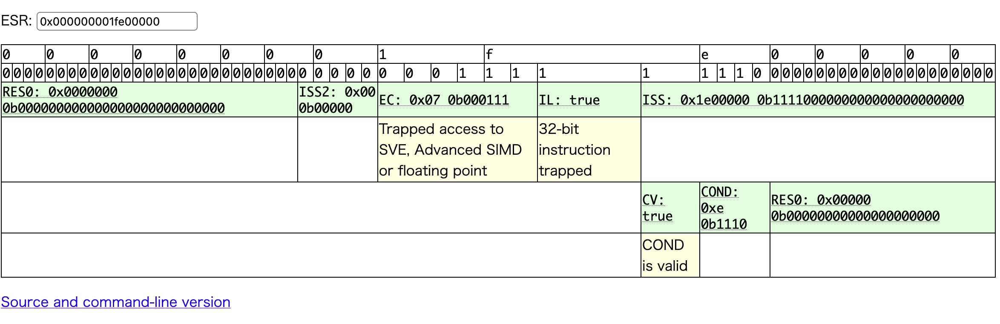
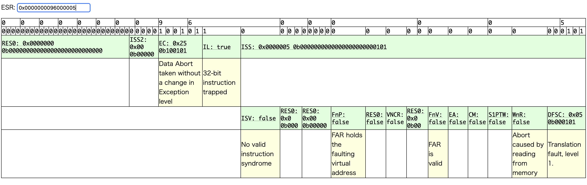

# プロセスを実装

- 何も動かない (2026/10/15)

## 2026/10/17

1. user.cを独立にコンパイルしてカーネルのrodataに埋め込む方式に変更してmain()までは
　進むようになる
    - user_process()のアドレスがmain.cから取得できなくなった
    - とりあえず、オブジェクトファイルを見て、固定値をセットした
    - user_strlen(), start_secondary_cores()をstatic inline関数として
      user.cを1関数にし、user_process()が_user_beginの戦闘になるようにした(10/19)

2. sched_init()のassert()でpanic
    - アドレスに問題はなくassert()の条件が間違っていた

3. sched_init()のmemset()でpanic
    - 小数点演算が有効になっていなかった
    - CPACR_VALUEを定義して、entry.Sのel2で設定

4. buddy_init()でpanic
    - PAGE_STARTの定義を高位アドレスに変更し忘れていた

5. sunxi_mmc.cのget32, put32で同期例外
    - get32, put32の第1引数はuint64_t（レジスタアドレス）であるが、
      `priv->reg->FIELD`となっており、これはuint32_t（レジスタ値）であり
      定義と異なるためであった。
    - `(uint64)&priv->reg->FIELD`とした

6. map_page()で同期例外
    - map_page(), map_table()で物理アドレスと仮想アドレスが適切に指定されていなかった

7. memcpy()で同期例外
    - 10/18はこれを調査（10/19は再現せず）

8. kernel_process()が動かない? (10/19)
    - switch(-1, 0)でinit()は動くが、initで実行されるはずのswitch(n, 1)が実行されない
    - デマンドページングをdo_mem_abortで処理しているのに、trap()でも処理している

9. 8項の問題に対処して同期例外が再現するようになる(10/20)
    - すべてのcpuがidle状態になってtask 1にswitchできないためで、
    　これはtimerでtimer_tick()を実行することで解消
    - do_mem_abortとtrapの2重処理に対処

10. init()がユーザ空間アドレスにならない
    - USER_TOP, move_to_user_mode()の第3引数を変更

## 2026/10/21

1. user.cを分割して、前半部分をビルドして文字列配列に変換してmain.cに組み込む

2. コアを1つだけで実行
    - elfヘッダーの定義が間違っていたので修正
3. 2番目のプログラムヘッダーの読み込みでエラー
    - ph.p_vaddrがページアラインであることを前提としていたが、ページアラインが
      必要なのは1番目のプログラムヘッダーだけだったので修正

## 2026/10/22

1. /bin/initの実行時にmuslでエラー

2. loadseg()を修正(milkv版xv6を参照)
    - 23日の持ち越し

## 2026/10/23

1. 前日2項の問題
    - ページヘッダーがページアラインしていない場合のユーザページ割り当てを修正

2. /bin/initのカーネル処理は正常終了したが、実行時エラーが発正

3. argv, envpの救った積込みがおかしい?
    - 正しく積まれていた
    - addr = 0x0 にアクセスしている
    - inicode.Sにexitの呼び出しを追加したが結果は同じ

## 2026/10/24

1. initcodeをuser.cのコードで置き換え
    - sys_execve()でエラーが発生し、user.cのコードが無限ループ

2. sys_execve()でエラーの場合、exitするようuser.cを変更
    - filecloseでパニック

3. 1項のエラーはsys_execve()のagrptr()内でユーザアドレスの範囲チェックでユーザスタックアドレスが
   考慮されていないためであった。
    - これを修正したところ、23日の3項と同じエラーとなった

4. initcode.Sに戻した
    - loadseg()でreadiしたpaをダンプしたが(20261024pm.logを参照)、正常にセットされていると思われた。

5. 一旦、凍結して、xv6のprocに変更することにする

## 2026/10/17の実行ログ

### 2026/10/17の1項

```bash
Disassembly of section .text:

0000000000001000 <print_to_console>:
    1000:	aa0003e1 	mov	x1, x0
    1004:	39400000 	ldrb	w0, [x0]
...

0000000000001040 <user_process>:
    1040:	90000000 	adrp	x0, 1000 <print_to_console>
    1044:	9106a000 	add	x0, x0, #0x1a8

$ xxd  obj/user_init/user.bin
00000000: e103 00aa 0000 4039 4001 0034 2504 00d1  ......@9@..4%...
00000010: 2300 80d2 1f20 03d5 e203 03aa 6304 0091  #.... ......c...
00000020: a468 6338 a4ff ff35 2000 8052 f5fb ff17  .hc8...5 ..R....
00000030: 0200 80d2 2000 8052 f2fb ff17 1f20 03d5  .... ..R..... ..
00000040: 0000 0090 00a0 0691 fd7b b8a9 e465 8e52  .........{...e.R <= 0x40をuser_process()のアドレスとして指定
```

```c
void kernel_process(void)
{
    uint64_t begin = (uint64_t)&_user_begin;
    uint64_t end   = (uint64_t)&_user_end;
    uint64_t process = begin + 0x40UL;
    int err = move_to_user_mode(begin, end - begin, process - begin);
    ...
}
```

- <user_process>を_user_beginの先頭にする

```bash
$ aarch64-none-elf-objdump -d obj/user_init/user.elf

obj/user_init/user.elf:     file format elf64-littleaarch64

Disassembly of section .text:

0000000000001000 <user_process>:
    1000:	90000000 	adrp	x0, 1000 <user_process>
    1004:	9105c000 	add	x0, x0, #0x170
    1008:	a9b87bfd 	stp	x29, x30, [sp, #-128]!
    100c:	d28c45e4 	mov	x4, #0x622f                	// #25135
```

### 2026/10/17の2項

```bash
Starting kernel ...

[0]irq_enable#154: GICD_ISENABLER[1]: 0x00000001
[0]main#123: console ok
[0]sched_init#75: tasks[0]=0xffff00004202b000               // tasks[0]
PANIC[0]sched_init#76: kern/sched.c:76: assertion failed.
```

### 2026/10/17の3項

```bash
[0]irq_enable#154: GICD_ISENABLER[1]: 0x00000001
[0]main#123: console ok
[0]sched_init#75: tasks[0]=0xffff00004202b000
[0]show_invalid_entry_message#127: SYNC_INVALID_EL1h, esr: 0x000000001fe00000, elr: 0xffff00004200a810, far: 0x00000
[0]show_invalid_entry_message#129: online esr decoder: https://esr.arm64.dev/#0x000000001fe00000
```



### 2026/10/17の4項

```bash
[0]irq_enable#154: GICD_ISENABLER[1]: 0x00000001
[0]main#123: console ok
[0]buddy_init#154: kernel_end: 0xffff000042056068, space: 0x10000083a9f98
PANIC[0]buddy_init#156: fix PAGE_START
```

### 2026/10/17の5項

```
[0]irq_enable#154: GICD_ISENABLER[1]: 0x00000001
[0]main#123: console ok
[0]buddy_init#154: kernel_end: 0xffff000042056068, space: 0x83a9f98
[0]buddy_init#199: buddy_init ok
[0]slab_cache_init#172: slab_cache_init ok
[0]irq_enable#154: GICD_ISENABLER[0]: 0x0800ffff
[0]clock_init#60: clock_init ok
[0]show_invalid_entry_message#127: SYNC_INVALID_EL1h, esr: 0x0000000096000005, elr: 0xffff000042008500, far: 0x0000000080000000
[0]show_invalid_entry_message#129: online esr decoder: https://esr.arm64.dev/#0x0000000096000005
```



### 2026/10/17の6項

```bash
[0]main#L124: console ok
[0]sched_init#L110: sched_init ok
[0]buddy_init#L199: buddy_init ok
[0]slab_cache_init#L172: slab_cache_init ok
[0]mm_init#L47: mm_init ok
[0]clock_init#L60: clock_init ok
[0]binit#L53: binit ok
[0]iinit#L192: iinit ok
[0]fileinit#L37: fileinit ok
[0]sunxi_mmc_probe#L513: sunxi_mmc_probe ok
[0]mmc_set_clock#L1149: clock is disabled (0Hz)
[0]mmc_select_mode#L158: selecting mode MMC legacy (freq : 0 MHz)
[0]mmc_set_clock#L1149: clock is enabled (400000Hz)
[0]sd_send_op_cond#L514: ocr: 0xc0ff8000, hc: 0x1
[0]mmc_start_init#L2062: mmc_start_init ok
[0]mmc_select_mode#L158: selecting mode MMC legacy (freq : 25 MHz)
[0]mmc_select_mode#L158: selecting mode SD High Speed (50MHz) (freq : 50 MHz)
[0]mmc_set_clock#L1149: clock is enabled (50000000Hz)
[0]mmc_complete_init#L2085: mmc_complete_init ok
[0]mmc_initialize#L2109: mmc_initialze ok
[0]sd_init#L64: partition[0]: TYPE: 12, LBA = 0xa000, #SECS = 0x19000
[0]sd_init#L64: partition[1]: TYPE: 131, LBA = 0x23000, #SECS = 0xf000
[0]sd_init#L69: sd_init ok

[0]rtc_init#L30: rtc_init ok
[1]secondary_main#L172: Hello core 1
[1]timer_init#L30: timer_init ok
[2]secondary_main#L172: Hello core 2
[3]secondary_main#L172: Hello core 3
[0]start_secondary_cores#L99: start cores ok
[3]timer_init#L30: timer_init ok
[2]timer_init#L30: timer_init ok
[2]map_page#L194: mm->pgd: 0xffff00004a7fd000 &(0x0xffff00004204b020)
[2]map_page#L209: [1] call map_table(0xfffe00004a7fd000, 39, 0x0, 0xffff00004202ddb4, 0xffff00004202ddb8)
[2]show_invalid_entry_message#L127: SYNC_INVALID_EL1h, esr: 0x0000000096000004, elr: 0xffff0000420085a8, far: 0xfffe00004a7fd000
```

### 2026/10/17の7項

```bash
[3]map_page#L185: va: 0x0, page: 0xffff00004a7fe000, alloc: 1, perm: 0x747
[0]timer_init#L30: timer_init ok
[3]map_page#L203: mm->pgd: 0x4a7fd000
[3]map_page#L218: before[1] table: pa(0x4a7fd000), va(0xffff00004a7fd000)
[3]map_table#L150: va: 0x0, shift: 39, table[0]: 0x0
[3]map_table#L166: table[0]: 0x4a7fc003, next_table: 0x4a7fc000
[3]map_page#L220: after [1] table: pa(0x4a7fc000), va(0xffff00004a7fc000)
[3]map_page#L218: before[2] table: pa(0x4a7fc000), va(0xffff00004a7fc000)
[3]map_table#L150: va: 0x0, shift: 30, table[0]: 0x0
[3]map_table#L166: table[0]: 0x4a7fb003, next_table: 0x4a7fb000
[3]map_page#L220: after [2] table: pa(0x4a7fb000), va(0xffff00004a7fb000)
[3]map_page#L218: before[3] table: pa(0x4a7fb000), va(0xffff00004a7fb000)
[3]map_table#L150: va: 0x0, shift: 21, table[0]: 0x0
[3]map_table#L166: table[0]: 0x4a7fa003, next_table: 0x4a7fa000
[3]map_page#L220: after [3] table: pa(0x4a7fa000), va(0xffff00004a7fa000)
[3]show_invalid_entry_message#L127: SYNC_INVALID_EL1h, esr: 0x0000000096000044, elr: 0xffff0000420125e8
```

### 2026/10/18の8項

- cpu0 だけで実行

```bash
[0]main#L124: console ok                // x19はinit()を, pcはret_from_fork()を指している
[0]sched_init#L110: init_task: pid: 0, x19: 0xffff000042013530, pc: 0xffff00004200f538, sp: 0xffff00004202c000
[0]sched_init#L112: sched_init ok
[0]buddy_init#L199: buddy_init ok
[0]slab_cache_init#L172: slab_cache_init ok
[0]mm_init#L47: mm_init ok
[0]clock_init#L60: clock_init ok
[0]binit#L53: binit ok
[0]iinit#L192: iinit ok
[0]fileinit#L37: fileinit ok
[0]sunxi_mmc_probe#L513: sunxi_mmc_probe ok
[0]mmc_set_clock#L1149: clock is disabled (0Hz)
[0]mmc_select_mode#L158: selecting mode MMC legacy (freq : 0 MHz)
[0]mmc_set_clock#L1149: clock is enabled (400000Hz)
[0]sd_send_op_cond#L514: ocr: 0xc0ff8000, hc: 0x1
[0]mmc_start_init#L2062: mmc_start_init ok
[0]mmc_select_mode#L158: selecting mode MMC legacy (freq : 25 MHz)
[0]mmc_select_mode#L158: selecting mode SD High Speed (50MHz) (freq : 50 MHz)
[0]mmc_set_clock#L1149: clock is enabled (50000000Hz)
[0]mmc_complete_init#L2085: mmc_complete_init ok
[0]mmc_initialize#L2109: mmc_initialze ok
[0]sd_init#L64: partition[0]: TYPE: 12, LBA = 0xa000, #SECS = 0x19000
[0]sd_init#L64: partition[1]: TYPE: 131, LBA = 0x23000, #SECS = 0xf000
[0]sd_init#L69: sd_init ok

[0]rtc_init#L30: rtc_init ok
[0]timer_init#L30: timer_init ok
[0]schedule#L158: switch task 0
switch 1235 ok
[0]switch_to#L224: prev: -1, next: 0
[0]init#L191: start arg: 0x0
[0]copy_process#L662: flags: 0x2, fn: 0xffff0000420132e0, arg: 0x0, name: kern-1    // fnはkernel_process()を指している
[0]copy_process#L688: kthread
[0]copy_process#L741: p->id 1 ok
[0]switch_to#L226: ok
[0]schedule#L179: ok
```

- マルチcpuで実行

```bash
[0]sched_init#L110: init_task: pid: 0, x19: 0xffff0000420135d0, pc: 0xffff00004200f538, sp: 0xffff00004202d000
[0]sched_init#L112: sched_init ok

[0]rtc_init#L30: rtc_init ok
[1]secondary_main#L172: Hello core 1
[1]timer_init#L30: timer_init ok
[2]secondary_main#L172: Hello core 2
[3]secondary_main#L172: Hello core 3
[2]timer_init#L30: timer_init ok
[1]schedule#L158: switch task 0
[3]timer_init#L30: timer_init ok
[1]switch_to#L221: prev: -1, next: 0
[0]start_secondary_cores#L99: start cores ok
[1]init#L191: start arg: 0x0
[2]schedule#L173: switch idle 2
[0]timer_init#L30: timer_init ok
[1]copy_process#L651: flags: 0x2, fn: 0xffff000042013380, arg: 0x0, name: kern-1
[2]schedule#L179: ok
[3]schedule#L173: switch idle 3
[3]schedule#L179: ok
[1]copy_process#L677: kthread
[1]copy_process#L730: p->id 1 ok
[0]schedule#L158: switch task 1
[0]switch_to#L221: prev: -1, next: 1
[1]switch_to#L223: ok
[0]move_to_user_mode#L610: start: 0xffff00004201f000, size: 0x194, pc: 0xffff00004201f000
[1]schedule#L179: ok
[0]fsinit#L56: fsinit ok
[0]kernel_process#L60: move_to_user_mode ok
[0]do_mem_abort#L568: demand paging at user va 0x7ffff80, elr 0xffff00004201f008    // elrは_usr_begin冒頭のstp命令
[0]trap#L83: triger ec: 36 at elr: 0xffff000042008bf4 with far: 0x7ffff80           // do_mem_abrot()とtrap()で重複処理?
[0]do_mem_abort#L549: bad user va? faulty addr 0xffff00004201f175 > USER_TOP 0x8000000
esr 0x9200000e, elr 0xffff00004201f018
[0]trap#L83: triger ec: 36 at elr: 0xffff000042008bf4 with far: 0xffff00004201f175  // get32()
show_stack_user: Call trace (pid 1 initusr):
addr2line -e ./usr/build/initusr.debug \
0xffff00004201f014 \
PANIC [0]walkaddr#L312: kern/vm.c:312: assertion failed.
```

```bash
[0]rtc_init#L30: rtc_init ok
[1]secondary_main#L172: Hello core 1
[1]timer_init#L30: timer_init ok
[2]secondary_main#L172: Hello core 2
[3]secondary_main#L172: Hello core 3
[1]schedule#L158: switch task 0
[0]start_secondary_cores#L99: start cores ok
[1]switch_to#L221: prev: -1, next: 0    // cpu1 -> task 0を開始
[2]timer_init#L30: timer_init ok
[0]timer_init#L30: timer_init ok
[2]schedule#L173: switch idle 2         // cpu2 -> idle
[1]init#L191: start arg: 0x0
[0]schedule#L173: switch idle 0         // cpu0 -> idle
[1]copy_process#L651: flags: 0x2, fn: 0xffff000042013380, arg: 0x0, name: kern-1
[2]schedule#L179: ok
[3]timer_init#L30: timer_init ok
[0]schedule#L179: ok
[1]copy_process#L677: kthread
[1]copy_process#L730: p->id 1 ok        // task 1が作成
[3]schedule#L158: switch task 1         // cpu3 -> task 1を開始
[3]switch_to#L221: prev: -1, next: 1
[3]move_to_user_mode#L610: start: 0xffff00004201f000, size: 0x194, pc: 0xffff00004201f000
[1]switch_to#L223: ok
[1]schedule#L179: ok
[3]fsinit#L56: fsinit ok
[3]move_to_user_mode#L640: ok

[3]kernel_process#L60: move_to_user_mode ok
[3]do_mem_abort#L569: demand paging at user va 0x7ffff80, elr 0xffff00004201f008
[3]trap#L83: triger ec: 36 at elr: 0xffff000042008c54 with far: 0x7ffff80
[3]do_mem_abort#L550: bad user va? faulty addr 0xffff00004201f175 > USER_TOP 0x8000000
esr 0x9200000e, elr 0xffff00004201f018
[3]trap#L83: triger ec: 36 at elr: 0xffff000042008c54 with far: 0xffff00004201f175
show_stack_user: Call trace (pid 1 initusr):
addr2line -e ./usr/build/initusr.debug \
0xffff00004201f014 \
[3]walkaddr#L312: va: 0x7fff000, *pte: 0x4a7f9747, pte_pa: 0x4a7f9000
PANIC [3]walkaddr#L313: kern/vm.c:313: assertion failed.
```

- debug出力を削除したら次のようにinit()が実行されないケースがある (switch_to(-1, 1)が実行されない）
- idle状態のcpuを起こすのはtimer_tick()だが、これを呼び出していなかった。
- uvaではARMシステムタイマーで時刻管理を、コアごとにあるARM汎用タイマーでこのtimer_tick()を駆動していた。
  ここでは時刻管理はclock.c, timer_tick()はtimer.cで操作する。

```bash
[0]rtc_init#L30: rtc_init ok
[1]secondary_main#L172: Hello core 1
[1]timer_init#L30: timer_init ok
[2]secondary_main#L172: Hello core 2
[1]schedule#L158: switch task 0
[3]secondary_main#L172: Hello core 3
[0]start_secondary_cores#L99: start cores ok
[1]switch_to#L221: prev: -1, next: 0
[0]timer_init#L30: timer_init ok
[3]timer_init#L30: timer_init ok
[2]timer_init#L30: timer_init ok
[0]schedule#L173: switch idle 0     // cpu0 -> idle
[1]init#L191: start arg: 0x0
[0]schedule#L179: ok
[1]copy_process#L651: flags: 0x2, fn: 0xffff000042013380, arg: 0x0, name: kern-1
[2]schedule#L173: switch idle 2     // cpu2 -> idle
[2]schedule#L179: ok
[3]schedule#L173: switch idle 3     // cpu3 -> idle
[3]schedule#L179: ok
[1]copy_process#L677: kthread
[1]copy_process#L730: p->id 1 ok    // task 1が作成されたがこれを実行するcpuがない
[1]switch_to#L223: ok
[1]schedule#L179: ok                // cpu1 -> ここで task 0を終了
```

## 2026/10/20

### 9項

```bash
[1]secondary_main#L173: Hello core 1
[1]timer_init#L31: timer_init ok
[2]secondary_main#L173: Hello core 2
[3]secondary_main#L173: Hello core 3
[1]init#L192: start arg: 0x0
[[02]]stitmaretr__isenciotn#dL3a1r:y _ctiomreesr#_Li1n0it0:  osk
tart cores ok
PANIC [2]release#L30: console is not locked     // これはleave_scheduler()のrelease()
[1]copy_process#L653: flags: 0x2, fn: 0xffff000042012d80, arg: 0x0, name: kern-1
[3]timer_init#L31: timer_init ok
[1]copy_process#L678: kthread
[0]timer_init#L31: timer_init ok
[3]kernel_process#L53: Kernel process started at EL 1, pid 1
[3]move_to_user_mode#L610: start: 0xffff00004201e000, size: 0xe8, pc: 0xffff00004201e000
[3]move_to_user_mode#L628: cur->mm->pgd: 0x4a7fd000
[1]copy_process#L731: p->id 1 ok
[3]fsinit#L56: fsinit ok
[3]move_to_user_mode#L640: ok

[3]kernel_process#L61: move_to_user_mode ok
[3]do_mem_abort#L569: demand paging at user va 0x7ffffb0, elr 0xffff00004201e008
// uvaでは　vm.c:619 demand paging at user va 0x7ffffa0, elr 0x12c とelrがユーザ空間アドレス
[3]do_mem_abort#L550: bad user va? faulty addr 0xffff00004201e0d0 > USER_TOP 0x8000000
esr 0x9200000e, elr 0xffff00004201e018
show_stack_user: Call trace (pid 1 initusr):
addr2line -e ./usr/build/initusr.debug \
0xffff00004201e014 \
[3]walkaddr#L312: va: 0x7fff000, *pte: 0x4a7f9747, pte_pa: 0x4a7f9000
PANIC [3]walkaddr#L313: kern/vm.c:313: assertion failed.
```

- obj/user_init/user.elf

```bash
0000000000001000 <user_process>:
    1000:       90000000        adrp    x0, 1000 <user_process>
    1004:       91034000        add     x0, x0, #0xd0
    1008:       a9bb7bfd        stp     x29, x30, [sp, #-80]!
    100c:       90000002        adrp    x2, 1000 <user_process>
    1010:       91030042        add     x2, x2, #0xc0
    1014:       910003fd        mov     x29, sp
    1018:       a9401c06        ldp     x6, x7, [x0]
    101c:       f9000bf3        str     x19, [sp, #16]
```

- obj/kernle8.elf

```bash
ffff000042012d80 <kernel_process>:
ffff000042012d80:       a9bd7bfd        stp     x29, x30, [sp, #-48]!
ffff000042012d84:       90000062        adrp    x2, ffff00004201e000 <_user_begin>
ffff000042012d88:       91000042        add     x2, x2, #0x0
ffff000042012d8c:       910003fd        mov     x29, sp
ffff000042012d90:       90000061        adrp    x1, ffff00004201e000 <_user_begin>

ffff00004201e000 <_user_begin>:
ffff00004201e000:       90000000        adrp    x0, ffff00004201e000 <_user_begin>
ffff00004201e004:       91034000        add     x0, x0, #0xd0       // x0 = ffff00004201e0do [x0] = 0x10b0
ffff00004201e008:       a9bb7bfd        stp     x29, x30, [sp, #-80]!
ffff00004201e00c:       90000002        adrp    x2, ffff00004201e000 <_user_begin> // x2 = ffff00004201e0c0
ffff00004201e010:       91030042        add     x2, x2, #0xc0       // [x2] = "/dev/console"
ffff00004201e014:       910003fd        mov     x29, sp
ffff00004201e018:       a9401c06        ldp     x6, x7, [x0]
ffff00004201e01c:       f9000bf3        str     x19, [sp, #16]
ffff00004201e02c:       52800043        mov     w3, #0x2                        // #2
ffff00004201e030:       f9400041        ldr     x1, [x2]
ffff00004201e034:       f90017e1        str     x1, [sp, #40]
ffff00004201e038:       12800c60        mov     w0, #0xffffff9c                 // #-100
ffff00004201e03c:       aa1303e1        mov     x1, x19
ffff00004201e040:       52801802        mov     w2, #0xc0                       // #192
ffff00004201e044:       f802d3e5        stur    x5, [sp, #45]
ffff00004201e048:       a9039fe6        stp     x6, x7, [sp, #56]
ffff00004201e04c:       f90027e4        str     x4, [sp, #72]
ffff00004201e050:       97fffbf2        bl      ffff00004201d018 <__func__.0+0x1110>
ffff00004201e054:       37f801a0        tbnz    w0, #31, ffff00004201e088 <_user_begin+0x88>
ffff00004201e058:       52800000        mov     w0, #0x0                        // #0
ffff00004201e05c:       97fffbf5        bl      ffff00004201d030 <__func__.0+0x1128>
ffff00004201e060:       52800000        mov     w0, #0x0                        // #0
ffff00004201e064:       97fffbf3        bl      ffff00004201d030 <__func__.0+0x1128>
ffff00004201e068:       9100e3e1        add     x1, sp, #0x38
ffff00004201e06c:       d2800002        mov     x2, #0x0                        // #0
ffff00004201e070:       90000000        adrp    x0, ffff00004201e000 <_user_begin>
ffff00004201e074:       9102e000        add     x0, x0, #0xb8
ffff00004201e078:       97fffbe5        bl      ffff00004201d00c <__func__.0+0x1104>
ffff00004201e07c:       f9400bf3        ldr     x19, [sp, #16]
ffff00004201e080:       a8c57bfd        ldp     x29, x30, [sp], #80
ffff00004201e084:       d65f03c0        ret
ffff00004201e088:       aa1303e1        mov     x1, x19
ffff00004201e08c:       d2802003        mov     x3, #0x100                      // #256
ffff00004201e090:       52840002        mov     w2, #0x2000                     // #8192
ffff00004201e094:       12800c60        mov     w0, #0xffffff9c                 // #-100
ffff00004201e098:       97fffbe3        bl      ffff00004201d024 <__func__.0+0x111c>
ffff00004201e09c:       aa1303e1        mov     x1, x19
ffff00004201e0a0:       52800043        mov     w3, #0x2                        // #2
ffff00004201e0a4:       52800002        mov     w2, #0x0                        // #0
ffff00004201e0a8:       12800c60        mov     w0, #0xffffff9c                 // #-100
ffff00004201e0ac:       97fffbdb        bl      ffff00004201d018 <__func__.0+0x1110>
ffff00004201e0b0:       17ffffea        b       ffff00004201e058 <_user_begin+0x58>
ffff00004201e0b4:       00000000
ffff00004201e0b8:       6e69622f        nib/    /bin/sh'0'
ffff00004201e0bc:       0068732f        .hs/
ffff00004201e0c0:       7665642f        ved/    /dev/console'0'
ffff00004201e0c4:       6e6f632f        noc/
ffff00004201e0c8:       656c6f73        elos
ffff00004201e0cc:       00000000
ffff00004201e0d0:       000010b8
ffff00004201e0d4:       00000000
ffff00004201e0d8:       000010b8

```

### 10項

```bash
[0]main#L128: console ok
[0]sched_init#L110: init_task: pid: 0, x19: 0xffff000042013860, pc: 0xffff00004200fd38, sp: 0xffff00004202d000
[0]sched_init#L112: sched_init ok
[0]buddy_init#L199: buddy_init ok
[0]slab_cache_init#L172: slab_cache_init ok
[0]mm_init#L47: mm_init ok
[0]clock_init#L60: clock_init ok
[0]binit#L53: binit ok
[0]iinit#L192: iinit ok
[0]fileinit#L37: fileinit ok
[0]sunxi_mmc_probe#L513: sunxi_mmc_probe ok
[0]mmc_set_clock#L1149: clock is disabled (0Hz)
[0]mmc_select_mode#L158: selecting mode MMC legacy (freq : 0 MHz)
[0]mmc_set_clock#L1149: clock is enabled (400000Hz)
[0]sd_send_op_cond#L514: ocr: 0xc0ff8000, hc: 0x1
[0]mmc_start_init#L2062: mmc_start_init ok
[0]mmc_select_mode#L158: selecting mode MMC legacy (freq : 25 MHz)
[0]mmc_select_mode#L158: selecting mode SD High Speed (50MHz) (freq : 50 MHz)
[0]mmc_set_clock#L1149: clock is enabled (50000000Hz)
[0]mmc_complete_init#L2085: mmc_complete_init ok
[0]mmc_initialize#L2109: mmc_initialze ok
[0]sd_init#L64: partition[0]: TYPE: 12, LBA = 0xa000, #SECS = 0x19000
[0]sd_init#L64: partition[1]: TYPE: 131, LBA = 0x23000, #SECS = 0xf000
[0]sd_init#L69: sd_init ok

[0]rtc_init#L30: rtc_init ok
[1]secondary_main#L176: Hello core 1
[1]timer_init#L31: timer_init ok
[2]secondary_main#L176: Hello core 2
[3]secondary_main#L176: Hello core 3
[1]leave_scheduler#L187: release: cpu 1 pid 0
[2]timer_init#L31: timer_init ok
[0]start_secondary_cores#L103: start cores ok
[1]init#L195: start arg: 0x0
[3]timer_init#L31: timer_init ok
[0]timer_init#L31: timer_init ok
[1]copy_process#L675: flags: 0x2, fn: 0xffff000042013580, arg: 0x0, name: kern-1
[1]copy_process#L701: kthread
[0]leave_scheduler#L187: release: cpu 0 pid 1
[1]copy_process#L755: p->id 1 ok
[0]kernel_process#L53: Kernel process started at EL 1, pid 1
[0]move_to_user_mode#L632: start: 0xffff00004201f000, size: 0xc5, pc: 0x0
[0]allocate_user_page_mm#L123: call map_page
[0]map_page#L183: mm: 0xffff00004204c000, va: 0x0, page: 0x4a7fe000, alloc: 1, perm: 0x747
[0]map_page#L206: [0] mm->pgd: 0x4a7fd000, kpage: 0x4a7fd000, descs: 0xffff00004204c020 (0x4a7fd000)
[0]map_page#L217: [1] table: 0x4a7fc000, allocated: 1, desc: 0xffff00004a7fd000
[0]map_page#L237: [1] kpage: 0x4a7fc000, descs: 0xffff00004a7fd000 (0x4a7fc003)
[0]map_page#L217: [2] table: 0x4a7fb000, allocated: 1, desc: 0xffff00004a7fc000
[0]map_page#L237: [2] kpage: 0x4a7fb000, descs: 0xffff00004a7fc000 (0x4a7fb003)
[0]map_page#L217: [3] table: 0x4a7fa000, allocated: 1, desc: 0xffff00004a7fb000
[0]map_page#L237: [3] kpage: 0x4a7fa000, descs: 0xffff00004a7fb000 (0x4a7fa003)
[0]map_page#L250: pte_va: 0xffff00004a7fa000 (0x4a7fe747)
[0]move_to_user_mode#L650: cur->mm->pgd: 0x4a7fd000
[0]fsinit#L56: fsinit ok
[0]move_to_user_mode#L662: ok

[0]kernel_process#L64: move_to_user_mode ok
[0]do_mem_abort#L554: addr: 0xffffffffffa0, dfs: 0x4
[0]do_mem_abort#L567: call map_page
[0]map_page#L183: mm: 0xffff00004204c000, va: 0xfffffffff000, page: 0x4a7f9000, alloc: 1, perm: 0x747
[0]map_page#L206: [0] mm->pgd: 0x4a7fd000, kpage: 0x0, descs: 0x0 (0x9102e00090000000)
[0]map_page#L217: [1] table: 0x4a7f8000, allocated: 1, desc: 0xffff00004a7fdff8
[0]map_page#L237: [1] kpage: 0x4a7f8000, descs: 0xffff00004a7fdff8 (0x4a7f8003)
[0]map_page#L217: [2] table: 0x4a7f7000, allocated: 1, desc: 0xffff00004a7f8ff8
[0]map_page#L237: [2] kpage: 0x4a7f7000, descs: 0xffff00004a7f8ff8 (0x4a7f7003)
[0]map_page#L217: [3] table: 0x4a7f6000, allocated: 1, desc: 0xffff00004a7f7ff8
[0]map_page#L237: [3] kpage: 0x4a7f6000, descs: 0xffff00004a7f7ff8 (0x4a7f6003)
[0]map_page#L250: pte_va: 0xffff00004a7f6ff8 (0x4a7f9747)                   // va = 0x1000000000000 - 0x60
[0]do_mem_abort#L576: demand paging at user va 0xffffffffffa0, elr 0x8      // ユーザスタックのデマンドページング
[0]do_mem_abort#L554: addr: 0x6e6900bd, dfs: 0x5
[0]do_mem_abort#L567: call map_page
[0]map_page#L183: mm: 0xffff00004204c000, va: 0x6e690000, page: 0x4a7f5000, alloc: 1, perm: 0x747
[0]map_page#L206: [0] mm->pgd: 0x4a7fd000, kpage: 0x0, descs: 0x0 (0x9102e00090000000)
[0]map_page#L217: [1] table: 0x4a7fc000, allocated: 0, desc: 0xffff00004a7fd000
[0]map_page#L237: [1] kpage: 0x0, descs: 0x0 (0x9102e00090000000)
[0]map_page#L217: [2] table: 0x4a7f4000, allocated: 1, desc: 0xffff00004a7fc008
[0]map_page#L237: [2] kpage: 0x4a7f4000, descs: 0xffff00004a7fc008 (0x4a7f4003)
[0]map_page#L217: [3] table: 0x4a7f3000, allocated: 1, desc: 0xffff00004a7f4b98
[0]map_page#L237: [3] kpage: 0x4a7f3000, descs: 0xffff00004a7f4b98 (0x4a7f3003)
[0]map_page#L250: pte_va: 0xffff00004a7f3480 (0x4a7f5747)
[0]do_mem_abort#L576: demand paging at user va 0x6e6900bd, elr 0x18         // このvaのアドレスはおかしい
[0]show_invalid_entry_message#L261: Unhandled EL0 sync exception, esr: 0x0000000082000004, elr: 0xfffffffffffff018, far: 0xfffffffffffff018
[0]show_invalid_entry_message#L263: online esr decoder: https://esr.arm64.dev/#0x0000000082000004
```

- <_user_begin>

```bash
ffff00004201f000 <_user_begin>:
ffff00004201f000:       90000000        adrp    x0, ffff00004201f000 <_user_begin>
ffff00004201f004:       9102e000        add     x0, x0, #0xb8
ffff00004201f008:       a9ba7bfd        stp     x29, x30, [sp, #-96]!           // demand page 1
ffff00004201f00c:       d28c45e4        mov     x4, #0x622f             // x4 = 0x622f
ffff00004201f010:       f2adcd24        movk    x4, #0x6e69, lsl #16    // x4 = 0x6e69622f -> 0x68732f6e69622f
ffff00004201f014:       910003fd        mov     x29, sp
ffff00004201f018:       f8405005        ldur    x5, [x0, #5]                    // demand page 2
     // x0 = 0xffff00004201f000 + 0xb8 = 0xffff00004201f0b8 + 5 = 0xffff00004201f0bd
...
ffff00004201f0b4:       00000000
ffff00004201f0b8:       7665642f        ved/    /dev/console
ffff00004201f0bc:       6e6f632f        noc/
ffff00004201f0c0:       656c6f73        elos
```

- user.elf, user.bin

```bash
$ aarch64-none-elf-objdump -d user.elf
0000000000001000 <user_process>:
    1000:	90000000 	adrp	x0, 1000 <user_process>
    1004:	9102e000 	add	x0, x0, #0xb8
    1008:	a9ba7bfd 	stp	x29, x30, [sp, #-96]!       // 96 = 0x60
    100c:	d28c45e4 	mov	x4, #0x622f                	// #25135
    1010:	f2adcd24 	movk	x4, #0x6e69, lsl #16    // x4 = 0x68732f6e69622f    /bin/sh
    1014:	910003fd 	mov	x29, sp
    1018:	f8405005 	ldur	x5, [x0, #5]            // x5 = console.
    101c:	9100a3e7 	add	x7, sp, #0x28
    1020:	910063e6 	add	x6, sp, #0x18
    1024:	f2ce65e4 	movk	x4, #0x732f, lsl #32
    1028:	f2e00d04 	movk	x4, #0x68, lsl #48
    102c:	9100c3e1 	add	x1, sp, #0x30               // x1 = /dev/console
    1030:	f9400002 	ldr	x2, [x0]                    // x2 = /dev/console
    1034:	f9001be2 	str	x2, [sp, #48]               // 48 (0x30) : /dev/console
    1038:	52800043 	mov	w3, #0x2                   	// #2   : O_RDWR
    103c:	12800c60 	mov	w0, #0xffffff9c            	// #-100 : AT_FDCWD
    1040:	52801802 	mov	w2, #0xc0                  	// #192 : (O_CREAT | O_EXCL)
    1044:	390063ff 	strb	wzr, [sp, #24]          // 24 (0x18): 0
    1048:	a90213e4 	stp	x4, x4, [sp, #32]           // 32 (0x20): /bin/sh, 40 (0x28): /bin/sh
    104c:	f80353e5 	stur	x5, [sp, #53]           // 53 (0x35): console.
    1050:	a9041be7 	stp	x7, x6, [sp, #64]           // 64 (0x40): /bin/sh,  72 (0x48): 0
    1054:	f9002bff 	str	xzr, [sp, #80]              // 80 (0x50): 0
    1058:	97fffbf0 	bl	18 <call_sys_open>
    105c:	37f80160 	tbnz	w0, #31, 1088 <user_process+0x88>   // if (ret < 0) goto 1088

    1060:	52800000 	mov	w0, #0x0                   	// #0
    1064:	97fffbf3 	bl	30 <call_sys_dup>           // dup(0)
    1068:	52800000 	mov	w0, #0x0                   	// #0
    106c:	97fffbf1 	bl	30 <call_sys_dup>           // dup(0)
    1070:	910103e1 	add	x1, sp, #0x40               // x1 = argv
    1074:	910083e0 	add	x0, sp, #0x20               // x0 = /bin/sh
    1078:	d2800002 	mov	x2, #0x0                   	// x2 = 0 (envp)
    107c:	97fffbe4 	bl	c <call_sys_exec>           // execve("/bin/sh", argv, envp)
    1080:	a8c67bfd 	ldp	x29, x30, [sp], #96         //
    1084:	d65f03c0 	ret

    1088:	9100c3e1 	add	x1, sp, #0x30               // x1 = /dev/console
    108c:	d2802003 	mov	x3, #0x100                 	// #256     : CONSOLE << 8
    1090:	52840002 	mov	w2, #0x2000                	// #8192    : S_IFCHR
    1094:	12800c60 	mov	w0, #0xffffff9c            	// #-100      : AT_FDCWD
    1098:	97fffbe3 	bl	24 <call_sys_mknod>         // mknod
    109c:	9100c3e1 	add	x1, sp, #0x30
    10a0:	52800043 	mov	w3, #0x2                   	// #2
    10a4:	52800002 	mov	w2, #0x0                   	// #0
    10a8:	12800c60 	mov	w0, #0xffffff9c            	// #-100
    10ac:	97fffbdb 	bl	18 <call_sys_open>          // open
    10b0:	17ffffec 	b	1060 <user_process+0x60>

$ xxd user.bin
00000000: 0000 0090 00e0 0291 fd7b baa9 e445 8cd2  .........{...E..
00000010: 24cd adf2 fd03 0091 0550 40f8 e7a3 0091  $........P@.....
00000020: e663 0091 e465 cef2 040d e0f2 e1c3 0091  .c...e..........
00000030: 0200 40f9 e21b 00f9 4300 8052 600c 8012  ..@.....C..R`...
00000040: 0218 8052 ff63 0039 e413 02a9 e553 03f8  ...R.c.9.....S..
00000050: e71b 04a9 ff2b 00f9 f0fb ff97 6001 f837  .....+......`..7
00000060: 0000 8052 f3fb ff97 0000 8052 f1fb ff97  ...R.......R....
00000070: e103 0191 e083 0091 0200 80d2 e4fb ff97  ................
00000080: fd7b c6a8 c003 5fd6 e1c3 0091 0320 80d2  .{...._...... ..
00000090: 0200 8452 600c 8012 e3fb ff97 e1c3 0091  ...R`...........
000000a0: 4300 8052 0200 8052 600c 8012 dbfb ff97  C..R...R`.......
000000b0: ecff ff17 0000 0000 2f64 6576 2f63 6f6e  ......../dev/con
000000c0: 736f 6c65 00                             sole.
```

## 2026/10/21

### 1項

- user.cとuser_sys.Sを分割してusr/initcode.Sとusr/src/init/main.cとする
- usr/initcode.Sをビルドしてimageファイルを配列に変換してmain.cに組み込む

    - usr/initcode.S

    ```bash
    #include "linux/syscall.h"

    .globl _start
    _start:
        mov   x8, #SYS_execve
        adr   x0, init
        mov   x1, 0
        mov   x2, 0
        svc   #0

    init:
        .string "/bin/init\0"

    .align 4
    _end:
    ```

    - ビルド

    ```bash
    icode: initcode.S
	$(CC) -std=gnu11 -mcpu=cortex-a53 -mtune=cortex-a53 -nostdinc -static -c initcode.S -o initcode.o -I ../../inc
	$(LD) -N -e _start -Ttext=0 -static -o initcode.out initcode.o
	$(STRIP) initcode.out
	$(OBJCOPY) -S -O binary initcode.out initcode
	$(OBJDUMP) -S initcode.out > initcode.asm
	xxd -i initcode initcode.inc
    ```

    - 配列

    ```c
    $ cat usr/initcode/initcode.inc
    unsigned char initcode[] = {
        0xa8, 0x1b, 0x80, 0xd2, 0x80, 0x00, 0x00, 0x10, 0x01, 0x00, 0x80, 0xd2,
        0x02, 0x00, 0x80, 0xd2, 0x01, 0x00, 0x00, 0xd4, 0x2f, 0x62, 0x69, 0x6e,
        0x2f, 0x69, 0x6e, 0x69, 0x74, 0x00, 0x00, 0x00
    };
    unsigned int initcode_len = 32;
    ```

    ```c
     void kernel_process(void)
    {
        int err = move_to_user_mode((uint64_t)initcode, initcode_len, 0);
    }
    ```


```bash
[0]main#L135: console ok
[0]sched_init#L110: init_task: pid: 0, x19: 0xffff0000420137e0, pc: 0xffff00004200fd38, sp: 0xffff00004202c000
[0]sched_init#L112: sched_init ok
[0]buddy_init#L199: buddy_init ok
[0]slab_cache_init#L172: slab_cache_init ok
[0]mm_init#L47: mm_init ok
[0]clock_init#L60: clock_init ok
[0]binit#L53: binit ok
[0]iinit#L192: iinit ok
[0]fileinit#L37: fileinit ok
[0]sunxi_mmc_probe#L513: sunxi_mmc_probe ok
[0]mmc_set_clock#L1149: clock is disabled (0Hz)
[0]mmc_select_mode#L158: selecting mode MMC legacy (freq : 0 MHz)
[0]mmc_set_clock#L1149: clock is enabled (400000Hz)
[0]sd_send_op_cond#L514: ocr: 0xc0ff8000, hc: 0x1
[0]mmc_start_init#L2062: mmc_start_init ok
[0]mmc_select_mode#L158: selecting mode MMC legacy (freq : 25 MHz)
[0]mmc_select_mode#L158: selecting mode SD High Speed (50MHz) (freq : 50 MHz)
[0]mmc_set_clock#L1149: clock is enabled (50000000Hz)
[0]mmc_complete_init#L2085: mmc_complete_init ok
[0]mmc_initialize#L2109: mmc_initialze ok
[0]sd_init#L64: partition[0]: TYPE: 12, LBA = 0xa000, #SECS = 0x19000
[0]sd_init#L64: partition[1]: TYPE: 131, LBA = 0x23000, #SECS = 0xf000
[0]sd_init#L69: sd_init ok

[0]rtc_init#L30: rtc_init ok
[1]secondary_main#L183: Hello core 1
[1]timer_init#L31: timer_init ok
[2]secondary_main#L183: Hello core 2
[1]leave_scheduler#L187: release: cpu 1 pid 0
[[32]]stiecmoernd_ainryit_m#aL3in1#: Lt18im3:e rH_ielnlito  cokor
e 3
[1]init#L202: start arg: 0x0
PANIC [2]release#L30: console is not locked
[3]timer_init#L31: timer_init ok
[1]copy_process#L675: flags: 0x2, fn: 0xffff000042013580, arg: 0x0, name: kern-1
[0]start_secondary_cores#L110: start cores ok
[1]copy_process#L701: kthread
[0]timer_init#L31: timer_init ok
[3]leave_scheduler#L187: release: cpu 3 pid 1
[3]move_to_user_mode#L632: start: 0xffff000042024020, size: 0x20, pc: 0x0
[1]copy_process#L755: p->id 1 ok
[3]allocate_user_page_mm#L123: call map_page
[3]map_page#L183: va: 0x0, page: 0x4a7fe000, alloc: 1, perm: 0x747
[3]map_page#L206: [0] mm->pgd: 0x4a7fd000, kpage: 0x4a7fd000, descs: 0xffff00004204b020 (0x4a7fd000)
[3]map_page#L217: [1] table: 0x4a7fc000, allocated: 1, desc: 0xffff00004a7fd000
[3]map_page#L237: [1] kpage: 0x4a7fc000, descs: 0xffff00004a7fd000 (0x4a7fc003)
[3]map_page#L217: [2] table: 0x4a7fb000, allocated: 1, desc: 0xffff00004a7fc000
[3]map_page#L237: [2] kpage: 0x4a7fb000, descs: 0xffff00004a7fc000 (0x4a7fb003)
[3]map_page#L217: [3] table: 0x4a7fa000, allocated: 1, desc: 0xffff00004a7fb000
[3]map_page#L237: [3] kpage: 0x4a7fa000, descs: 0xffff00004a7fb000 (0x4a7fa003)
[3]map_page#L250: pte_va: 0xffff00004a7fa000 (0x4a7fe747)
[3]move_to_user_mode#L650: cur->mm->pgd: 0x4a7fd000
[3]fsinit#L56: fsinit ok
[3]move_to_user_mode#L662: ok

[3]kernel_process#L71: move_to_user_mode ok
[3]walkaddr#L309: call map_page
[3]map_page#L183: va: 0x0, page: 0x0, alloc: 0, perm: 0x0
[3]map_page#L206: [0] mm->pgd: 0x4a7fd000, kpage: 0x0, descs: 0x0 (0x10000080d2801ba8)
[3]map_page#L217: [1] table: 0x4a7fc000, allocated: 0, desc: 0xffff00004a7fd000
[3]map_page#L237: [1] kpage: 0x0, descs: 0x0 (0x10000080d2801ba8)
[3]map_page#L217: [2] table: 0x4a7fb000, allocated: 0, desc: 0xffff00004a7fc000
[3]map_page#L237: [2] kpage: 0x0, descs: 0x0 (0x10000080d2801ba8)
[3]map_page#L217: [3] table: 0x4a7fa000, allocated: 0, desc: 0xffff00004a7fb000
[3]map_page#L237: [3] kpage: 0x0, descs: 0x0 (0x10000080d2801ba8)
[3]map_page#L250: pte_va: 0xffff00004a7fa000 (0x4a7fe747)
[3]walkaddr#L317: va: 0x0, *pte: 0x4a7fe747, pte_pa: 0x4a7fe000
[3]allocate_user_page_mm#L123: call map_page
[3]map_page#L183: va: 0xfffffffff000, page: 0x4a7f8000, alloc: 1, perm: 0x747
[3]map_page#L189: no more user pages
[3]allocate_user_page_mm#L127: map_page failed: va=0xfffffffff000, pa=0x4a7f8000, perm=0x747
[3]exec#L220: exec failed
[3]do_mem_abort#L554: addr: 0xffffffffffffff70, dfs: 0x4
[3]do_mem_abort#L556: bad user va? faulty addr 0xffffffffffffff70 > USER_TOP 0x0
esr 0x92000004, elr 0x18
show_stack_user: Call trace (pid 1 initusr):
addr2line -e ./usr/build/initusr.debug \
0x14 \
[1]free_user_page_range#L488: call map_page
[1]map_page#L183: va: 0x0, page: 0x0, alloc: 0, perm: 0x0
[1]map_page#L206: [0] mm->pgd: 0x4a7fd000, kpage: 0x0, descs: 0x0 (0xea000006ea000008)
[1]map_page#L217: [1] table: 0x4a7fc000, allocated: 0, desc: 0xffff00004a7fd000
[1]map_page#L237: [1] kpage: 0x0, descs: 0x0 (0xea000006ea000008)
[1]map_page#L217: [2] table: 0x4a7fb000, allocated: 0, desc: 0xffff00004a7fc000
[1]map_page#L237: [2] kpage: 0x0, descs: 0x0 (0xea000006ea000008)
[1]map_page#L217: [3] table: 0x4a7fa000, allocated: 0, desc: 0xffff00004a7fb000
[1]map_page#L237: [3] kpage: 0x0, descs: 0x0 (0xea000006ea000008)
[1]map_page#L250: pte_va: 0xffff00004a7fa000 (0x4a7fe747)
[1]free_user_page_range#L491: faile map_page: va: 0x0, cnt: 0
PANIC [1]growproc#L532: kern/vm.c:532: assertion failed.
```

### 2項

```bash
[0]main#L135: console ok
[0]sched_init#L110: init_task: pid: 0, x19: 0xffff000042012fe0, pc: 0xffff00004200f538, sp: 0xffff00004202b000
[0]sched_init#L112: sched_init ok
[0]buddy_init#L199: buddy_init ok
[0]slab_cache_init#L172: slab_cache_init ok
[0]mm_init#L47: mm_init ok
[0]clock_init#L60: clock_init ok
[0]binit#L53: binit ok
[0]iinit#L192: iinit ok
[0]fileinit#L37: fileinit ok
[0]sunxi_mmc_probe#L513: sunxi_mmc_probe ok
[0]mmc_set_clock#L1149: clock is disabled (0Hz)
[0]mmc_select_mode#L158: selecting mode MMC legacy (freq : 0 MHz)
[0]mmc_set_clock#L1149: clock is enabled (400000Hz)
[0]sd_send_op_cond#L514: ocr: 0xc0ff8000, hc: 0x1
[0]mmc_start_init#L2062: mmc_start_init ok
[0]mmc_select_mode#L158: selecting mode MMC legacy (freq : 25 MHz)
[0]mmc_select_mode#L158: selecting mode SD High Speed (50MHz) (freq : 50 MHz)
[0]mmc_set_clock#L1149: clock is enabled (50000000Hz)
[0]mmc_complete_init#L2085: mmc_complete_init ok
[0]mmc_initialize#L2109: mmc_initialze ok
[0]sd_init#L64: partition[0]: TYPE: 12, LBA = 0xa000, #SECS = 0x19000
[0]sd_init#L64: partition[1]: TYPE: 131, LBA = 0x23000, #SECS = 0xf000
[0]sd_init#L69: sd_init ok

[0]rtc_init#L30: rtc_init ok
[0]timer_init#L31: timer_init ok
[0]leave_scheduler#L187: release: cpu 0 pid 0
[0]init#L202: start arg: 0x0
[0]copy_process#L675: flags: 0x2, fn: 0xffff000042012d80, arg: 0x0, name: kern-1
[0]copy_process#L701: kthread
[0]copy_process#L755: p->id 1 ok
[0]leave_scheduler#L187: release: cpu 0 pid 1
[0]move_to_user_mode#L632: start: 0xffff000042023020, size: 0x20, pc: 0x0
[0]allocate_user_page_mm#L123: call map_page
[0]map_page#L183: va: 0x0, page: 0x4a7fe000, alloc: 1, perm: 0x747
[0]map_page#L237: [1] kpage: 0x4a7fc000, descs: 0xffff00004a7fd000 (0x4a7fc003)
[0]map_page#L237: [2] kpage: 0x4a7fb000, descs: 0xffff00004a7fc000 (0x4a7fb003)
[0]map_page#L237: [3] kpage: 0x4a7fa000, descs: 0xffff00004a7fb000 (0x4a7fa003)
[0]move_to_user_mode#L650: cur->mm->pgd: 0x4a7fd000
[0]fsinit#L56: fsinit ok
[0]move_to_user_mode#L662: ok

[0]kernel_process#L71: move_to_user_mode ok
[0]walkaddr#L309: call map_page
[0]map_page#L183: va: 0x0, page: 0x0, alloc: 0, perm: 0x0
[0]map_page#L237: [1] kpage: 0x0, descs: 0x0 (0x10000080d2801ba8)
[0]map_page#L237: [2] kpage: 0x0, descs: 0x0 (0x10000080d2801ba8)
[0]map_page#L237: [3] kpage: 0x0, descs: 0x0 (0x10000080d2801ba8)
[0]walkaddr#L317: va: 0x0, *pte: 0x4a7fe747, pte_pa: 0x4a7fe000
[0]exec#L48: pid 1 exec called. path /bin/init
[0]allocate_user_page_mm#L123: call map_page
[0]map_page#L183: va: 0xfffffffff000, page: 0x4a7f8000, alloc: 1, perm: 0x747
[0]map_page#L237: [1] kpage: 0x4a7f6000, descs: 0xffff00004a7f7ff8 (0x4a7f6003)
[0]map_page#L237: [2] kpage: 0x4a7f5000, descs: 0xffff00004a7f6ff8 (0x4a7f5003)
[0]map_page#L237: [3] kpage: 0x4a7f4000, descs: 0xffff00004a7f5ff8 (0x4a7f4003)
[0]allocate_user_page_mm#L123: call map_page
[0]map_page#L183: va: 0xffffffeff000, page: 0x4a7f3000, alloc: 1, perm: 0x707
[0]map_page#L237: [1] kpage: 0x0, descs: 0x0 (0x10000080d2801ba8)
[0]map_page#L237: [2] kpage: 0x0, descs: 0x0 (0x10000080d2801ba8)
[0]map_page#L237: [3] kpage: 0x0, descs: 0x0 (0x10000080d2801ba8)
[0]walkaddr#L309: call map_page
[0]map_page#L183: va: 0xfffffffff000, page: 0x0, alloc: 0, perm: 0x0
[0]map_page#L237: [1] kpage: 0x0, descs: 0x0 (0x10000080d2801ba8)
[0]map_page#L237: [2] kpage: 0x0, descs: 0x0 (0x10000080d2801ba8)
[0]map_page#L237: [3] kpage: 0x0, descs: 0x0 (0x10000080d2801ba8)
[0]walkaddr#L317: va: 0xfffffffff000, *pte: 0x4a7f8747, pte_pa: 0x4a7f8000
[0]walkaddr#L309: call map_page
[0]map_page#L183: va: 0xfffffffff000, page: 0x0, alloc: 0, perm: 0x0
[0]map_page#L237: [1] kpage: 0x0, descs: 0x0 (0x10000080d2801ba8)
[0]map_page#L237: [2] kpage: 0x0, descs: 0x0 (0x10000080d2801ba8)
[0]map_page#L237: [3] kpage: 0x0, descs: 0x0 (0x10000080d2801ba8)
[0]walkaddr#L317: va: 0xfffffffff000, *pte: 0x4a7f8747, pte_pa: 0x4a7f8000
[0]exec#L191: pid 1 (init) commit to user VM, sp 0xffffffffffe0
[0]growproc#L510: sz: 0x1000, incr: 0xfffff000
[0]free_user_page_range#L484: va: 0x0, size: 0x1000
[0]free_user_page_range#L489: call map_page
[0]map_page#L183: va: 0x0, page: 0x0, alloc: 0, perm: 0x0
[0]map_page#L237: [1] kpage: 0x0, descs: 0x0 (0x10000080d2801ba8)
[0]map_page#L237: [2] kpage: 0x0, descs: 0x0 (0x10000080d2801ba8)
[0]map_page#L237: [3] kpage: 0x0, descs: 0x0 (0x10000080d2801ba8)
[0]exec#L201: pid 1 p->mm ffff00004204a000 p->mm->sz 0
[0]exec#L206: pid 1 exec succeeds
[0]show_invalid_entry_message#L261: Unhandled EL0 sync exception, esr: 0x000000008a000000, elr: 0x0000000100b70002, far: 0x0000000100b70002
[0]show_invalid_entry_message#L263: online esr decoder: https://esr.arm64.dev/#0x000000008a000000
```

```bash
[0]kernel_process#L71: move_to_user_mode ok
[0]exec#L48: pid 1 exec called. path /bin/init
[0]exec#L61: ELF: entry: 0x100b70002, phoff: 0x400104, phnum: 0x0
[0]exec#L194: pid 1 (init) commit to user VM, sp 0xffffffffffe0
[0]exec#L204: pid 1 p->mm ffff00004204a000 p->mm->sz 0
[0]exec#L209: pid 1 exec succeeds
[0]show_invalid_entry_message#L261: Unhandled EL0 sync exception, esr: 0x000000008a000000, elr: 0x0000000100b70002, far: 0x0000000100b70002
[0]show_invalid_entry_message#L263: online esr decoder: https://esr.arm64.dev/#0x000000008a000000
```

### 3項

```bash
[[0]leave_scheduler#L187: release: cpu 0 pid 0
[0]init#L202: start arg: 0x0
[0]copy_process#L675: flags: 0x2, fn: 0xffff000042012d80, arg: 0x0, name: kern-1
[0]copy_process#L701: kthread
[0]copy_process#L755: p->id 1 ok
[0]leave_scheduler#L187: release: cpu 0 pid 1
[0]move_to_user_mode#L632: start: 0xffff000042023020, size: 0x20, pc: 0x0
[0]map_page#L217: [1] table: 0x4a7fc000, allocated: 1, desc: 0xffff00004a7fd000
[0]map_page#L217: [2] table: 0x4a7fb000, allocated: 1, desc: 0xffff00004a7fc000
[0]map_page#L217: [3] table: 0x4a7fa000, allocated: 1, desc: 0xffff00004a7fb000
[0]move_to_user_mode#L650: cur->mm->pgd: 0x4a7fd000
[0]fsinit#L56: fsinit ok
[0]move_to_user_mode#L662: ok

[0]kernel_process#L71: move_to_user_mode ok
[0]map_page#L217: [1] table: 0x4a7fc000, allocated: 0, desc: 0xffff00004a7fd000
[0]map_page#L217: [2] table: 0x4a7fb000, allocated: 0, desc: 0xffff00004a7fc000
[0]map_page#L217: [3] table: 0x4a7fa000, allocated: 0, desc: 0xffff00004a7fb000
[0]walkaddr#L317: va: 0x0, *pte: 0x4a7fe747, pte_pa: 0x4a7fe000
[0]exec#L49: pid 1 exec called. path /bin/init
[0]exec#L62: ELF: entry: 0x400104, phoff: 0x40, phnum: 0x3
[0]exec#L89: pid: 1, vaddr: 0x400000, fsz: 0x1fa0, sz: 0x0
[0]map_page#L217: [1] table: 0x4a7f6000, allocated: 1, desc: 0xffff00004a7f7000
[0]map_page#L217: [2] table: 0x4a7f5000, allocated: 1, desc: 0xffff00004a7f6000
[0]map_page#L217: [3] table: 0x4a7f4000, allocated: 1, desc: 0xffff00004a7f5010
[0]map_page#L217: [1] table: 0x4a7f6000, allocated: 0, desc: 0xffff00004a7f7000
[0]map_page#L217: [2] table: 0x4a7f5000, allocated: 0, desc: 0xffff00004a7f6000
[0]map_page#L217: [3] table: 0x4a7f4000, allocated: 0, desc: 0xffff00004a7f5010
[0]loadseg#L240: va: 0x400000, ino: 8, offset: 0x1000, sz: 0x1fa0
[0]map_page#L217: [1] table: 0x4a7f6000, allocated: 0, desc: 0xffff00004a7f7000
[0]map_page#L217: [2] table: 0x4a7f5000, allocated: 0, desc: 0xffff00004a7f6000
[0]map_page#L217: [3] table: 0x4a7f4000, allocated: 0, desc: 0xffff00004a7f5010
[0]walkaddr#L317: va: 0x400000, *pte: 0x4a7f8787, pte_pa: 0x4a7f8000
[0]loadseg#L254: P2V(pa): 0xffff00004a7f8000, offset: 0x1000, n: 4096
[0]map_page#L217: [1] table: 0x4a7f6000, allocated: 0, desc: 0xffff00004a7f7000
[0]map_page#L217: [2] table: 0x4a7f5000, allocated: 0, desc: 0xffff00004a7f6000
[0]map_page#L217: [3] table: 0x4a7f4000, allocated: 0, desc: 0xffff00004a7f5010
[0]walkaddr#L317: va: 0x401000, *pte: 0x4a7f3787, pte_pa: 0x4a7f3000
[0]loadseg#L254: P2V(pa): 0xffff00004a7f3000, offset: 0x2000, n: 4000
[0]exec#L89: pid: 1, vaddr: 0x402fa0, fsz: 0x190, sz: 0x402000
[0]map_page#L217: [1] table: 0x0, allocated: 0, desc: 0xffff00004a7f7ff8
[0]map_page#L231: pud: we reached nonexisting pgtable, and asked not to alloc
[0]map_page#L260: failed. reverse allocated pgtables during tree walk
[0]free_user_page_range#L492: map_page failed: i: 0xffffffff00000000, cnt: 0
PANIC [0]growproc#L535: kern/vm.c:535: assertion failed.
```

```bash
$ aarch64-none-elf-readelf -lW obj/usr/bin/init

Elf file type is EXEC (Executable file)
Entry point 0x400104
There are 3 program headers, starting at offset 64

Program Headers:
  Type           Offset   VirtAddr           PhysAddr           FileSiz  MemSiz   Flg Align
  LOAD           0x001000 0x0000000000400000 0x0000000000400000 0x001fa0 0x001fa0 R E 0x1000
  LOAD           0x002fa0 0x0000000000402fa0 0x0000000000402fa0 0x000190 0x000808 RW  0x1000
  GNU_STACK      0x000000 0x0000000000000000 0x0000000000000000 0x000000 0x000000 RW  0x10

 Section to Segment mapping:
  Segment Sections...
   00     .init .text .fini .rodata
   01     .got .got.plt .data .bss
   02
```

## 2026/10/22

### 1項の出力

```bash
[0]leave_scheduler#L187: release: cpu 0 pid 0
[0]init#L202: start arg: 0x0
[0]copy_process#L675: flags: 0x2, fn: 0xffff000042012d80, arg: 0x0, name: kern-1
[0]copy_process#L701: kthread
[0]copy_process#L755: p->id 1 ok
[0]leave_scheduler#L187: release: cpu 0 pid 1
[0]move_to_user_mode#L632: start: 0xffff000042023020, size: 0x20, pc: 0x0
[0]move_to_user_mode#L650: cur->mm->pgd: 0x4a7fd000
[0]fsinit#L56: fsinit ok
[0]kernel_process#L71: move_to_user_mode ok
[0]exec#L49: pid 1 exec called. path /bin/init
[0]exec#L62: ELF: entry: 0x400104, phoff: 0x40, phnum: 0x3
[0]exec#L89: ph[0]: pid: 1, vaddr: 0x400000, fsz: 0x1fa0, msz: 0x1fa0, sz: 0x0
[0]loadseg#L240: va: 0x400000, ino: 8, offset: 0x1000, sz: 0x1fa0
[0]exec#L89: ph[1]: pid: 1, vaddr: 0x402fa0, fsz: 0x190, msz: 0x808, sz: 0x402000
[0]loadseg#L240: va: 0x402fa0, ino: 8, offset: 0x2fa0, sz: 0x190
[0]exec#L209: path: /bin/init, pid 1 exec succeeds, return 0
[0]do_mem_abort#L558: addr: 0x4035f8, dfs: 0x7
[0]do_mem_abort#L580: demand paging at user va 0x4035f8, elr 0x400178
[0]do_mem_abort#L558: addr: 0x401f18, dfs: 0xf
[0]do_mem_abort#L584: cannot handle: not translation fault.
FAR 0x0000000000401f18
ESR 0x9200000f
ELR 0x0000000000400214
[0]do_mem_abort#L586: online esr decoder: https://esr.arm64.dev/#0x000000009200000f
show_stack_user: Call trace (pid 1 init):
addr2line -e ./usr/build/init.debug \
0x400210 \
[0]show_invalid_entry_message#L261: SYNC_INVALID_EL1h, esr: 0x0000000096000006, elr: 0xffff000042017ab0, f4
[0]show_invalid_entry_message#L263: online esr decoder: https://esr.arm64.dev/#0x0000000096000006
```

### 2項

```bash
[0]exec#L51: pid 1 exec called. path /bin/init
[0]exec#L64: ELF: entry: 0x400104, phoff: 0x40, phnum: 0x3

[0]exec#L91: ph[0]: pid: 1, vaddr: 0x400000, fsz: 0x1fa0, msz: 0x1fa0, sz: 0x0

[0]allocate_user_page_mm#L124: va: 0x400000, page: 0x4a7f8000, alloc: 1, perm: 0x7c7
[0]exec#L103: kva: 0xffff00004a7f8000
[0]allocate_user_page_mm#L124: va: 0x401000, page: 0x4a7f3000, alloc: 1, perm: 0x7c7
[0]exec#L103: kva: 0xffff00004a7f3000

[0]loadseg#L258: va: 0x400000, ino: 8, offset: 0x1000, sz: 0x1fa0, addr: 0x0

[0]walkaddr#L320: va: 0x400000, pa: 0x4a7f8000
[0]loadseg#L277: pa: 0x4a7f8000, offset: 0x1000, n: 0x1000
[0]walkaddr#L320: va: 0x401000, pa: 0x4a7f3000
[0]loadseg#L277: pa: 0x4a7f3000, offset: 0x2000, n: 0xfa0

[0]exec#L91: ph[1]: pid: 1, vaddr: 0x402fa0, fsz: 0x190, msz: 0x808, sz: 0x402000

[0]allocate_user_page_mm#L124: va: 0x402fa0, page: 0x4a7f2000, alloc: 1, perm: 0x747
[0]exec#L103: kva: 0xffff00004a7f2000

[0]loadseg#L258: va: 0x402fa0, ino: 8, offset: 0x2fa0, sz: 0x190, addr: 0xfa0

[0]walkaddr#L310: va: 0x402fa0
[0]walkaddr#L320: va: 0x402fa0, pa: 0x4a7f2000
[0]loadseg#L277: pa: 0x4a7f2fa0, offset: 0x2fa0, n: 0x60
[0]walkaddr#L310: va: 0x403000
[0]walkaddr#L315: pte (*pte: 0x0) found but invalid 0000000000000000, 0000000000000707
PANIC [0]loadseg#L265: loadseg: address should exist
```

## 2026/10/23

### 1項

```bash
[0]exec#L51: pid 1 exec called. path /bin/init
[0]exec#L64: ELF: entry: 0x400104, phoff: 0x40, phnum: 0x3

[0]exec#L91: ph[0]: pid: 1, vaddr: 0x400000, fsz: 0x1fa0, msz: 0x1fa0, sz: 0x0
[0]allocate_user_page_mm#L124: va: 0x400000, page: 0x4a7f8000, alloc: 1, perm: 0x7c7
[0]allocate_user_page_mm#L124: va: 0x401000, page: 0x4a7f3000, alloc: 1, perm: 0x7c7
[0]loadseg#L258: va: 0x400000, ino: 8, offset: 0x1000, sz: 0x1fa0, addr: 0x0
[0]walkaddr#L310: va: 0x400000
[0]walkaddr#L320: va: 0x400000, pa: 0x4a7f8000
[0]loadseg#L277: pa: 0x4a7f8000, offset: 0x1000, n: 0x1000
[0]walkaddr#L310: va: 0x401000
[0]walkaddr#L320: va: 0x401000, pa: 0x4a7f3000
[0]loadseg#L277: pa: 0x4a7f3000, offset: 0x2000, n: 0xfa0

[0]exec#L91: ph[1]: pid: 1, vaddr: 0x402fa0, fsz: 0x190, msz: 0x808, sz: 0x402000
[0]allocate_user_page_mm#L124: va: 0x402000, page: 0x4a7f2000, alloc: 1, perm: 0x747
[0]allocate_user_page_mm#L124: va: 0x403000, page: 0x4a7f1000, alloc: 1, perm: 0x747
[0]loadseg#L258: va: 0x402fa0, ino: 8, offset: 0x2fa0, sz: 0x190, addr: 0xfa0
[0]walkaddr#L310: va: 0x402fa0
[0]walkaddr#L320: va: 0x402fa0, pa: 0x4a7f2000
[0]loadseg#L277: pa: 0x4a7f2fa0, offset: 0x2fa0, n: 0x60
[0]walkaddr#L310: va: 0x403000
[0]walkaddr#L320: va: 0x403000, pa: 0x4a7f1000
[0]loadseg#L277: pa: 0x4a7f1000, offset: 0x3000, n: 0x130

[0]allocate_user_page_mm#L124: va: 0xfffffffff000, page: 0x4a7f0000, alloc: 1, perm: 0x747
[0]allocate_user_page_mm#L124: va: 0xffffffeff000, page: 0x4a7dc000, alloc: 1, perm: 0x707
[0]walkaddr#L310: va: 0xfffffffff000
[0]walkaddr#L320: va: 0xfffffffff000, pa: 0x4a7f0000
[0]walkaddr#L310: va: 0xfffffffff000
[0]walkaddr#L320: va: 0xfffffffff000, pa: 0x4a7f0000
[0]walkaddr#L310: va: 0xfffffffff000
[0]walkaddr#L320: va: 0xfffffffff000, pa: 0x4a7f0000

[0]exec#L225: path: /bin/init, pid 1 exec succeeds, return 0

[0]show_invalid_entry_message#L261: SYNC_INVALID_EL1h, esr: 0x0000000086000006, elr: 0x0000000000000000, far: 0x0000000000000000
[0]show_invalid_entry_message#L263: online esr decoder: https://esr.arm64.dev/#0x0000000086000006
```

### 3項

```bash
+--------------------+-------------------------------------------------+------------------+
| 0x0000ffffffffffc0 | 00 00 00 00 00 00 00 00 00 00 00 00 00 00 00 00 | ................ |
| 0x0000ffffffffffd0 | 00 00 00 00 00 00 00 00 00 00 00 00 00 00 00 00 | ................ |
| 0x0000ffffffffffe0 | 06 00 00 00 00 00 00 00 00 10 00 00 00 00 00 00 | ................ |
| 0x0000fffffffffff0 | 00 00 00 00 00 00 00 00 00 00 00 00 00 00 00 00 | ................ |
+--------------------+-------------------------------------------------+------------------+
```

- argv[] = { "/bin/init", 0 }, envp = { "PATH=/bin", 0 } を追加

```bash
[0]exec#L51: pid: 1, path: /bin/init, argv: 0xffff00004202bce0, envp: 0xffff00004202bde0
=== stack dump ===
+--------------------+-----------------------------------------+------------------+
| 0x0000ffffffffff90 | 0100 0000 0600 0000 0000 0000 0000 0000 | ................ |
| 0x0000ffffffffffa0 | e0ff ffff ffff 0000 0000 0000 0000 0000 | ................ |
| 0x0000ffffffffffb0 | f0ff ffff ffff 0000 0000 0000 0000 0000 | ................ |
| 0x0000ffffffffffc0 | 0600 0000 0000 0000 0010 0000 0000 0000 | ................ |
| 0x0000ffffffffffd0 | 0000 0000 0000 0000 0000 0000 0000 0000 | ................ |
| 0x0000ffffffffffe0 | 5041 5448 3d2f 6269 6e00 0000 0000 0000 | PATH=/bin....... |
| 0x0000fffffffffff0 | 2f62 696e 2f69 6e69 7400 0000 0000 0000 | /bin/init....... |
+--------------------+-----------------------------------------+------------------+

[0]exec#L236: path: /bin/init, pid 1 exec succeeds, return 1
[0]show_invalid_entry_message#L261: SYNC_INVALID_EL1h, esr: 0x0000000086000006, elr: 0x0000000000000000, far: 0x0000000000000000
[0]show_invalid_entry_message#L263: online esr decoder: https://esr.arm64.dev/#0x0000000086000006
```

- argv, envpは正しく積まれている

```bash
0x0000fffffffffff8 | 7400 0000 0000 0000
0x0000fffffffffff0 | 2f62 696e 2f69 6e69    // /bin/init : argv[0]
0x0000ffffffffffe8 | 6e00 0000 0000 0000
0x0000ffffffffffe0 | 5041 5448 3d2f 6269    // PATH=/bin : envp[0]
0x0000ffffffffffd8 | 0000 0000 0000 0000    // auxv[3]
0x0000ffffffffffd0 | 0000 0000 0000 0000    // auxv[2]   = 0 : AT_NULL
0x0000ffffffffffc8 | 0010 0000 0000 0000    // auxv[1]   = 0x1000
0x0000ffffffffffc0 | 0600 0000 0000 0000    // auxv[0]   = 6 : AT_PAGESZ
0x0000ffffffffffb8 | 0000 0000 0000 0000    // estack[1] = 0
0x0000ffffffffffb0 | f0ff ffff ffff 0000    // estack[0] = 0xffffffffff0f   -> argv[0]
0x0000ffffffffffa8 | 0000 0000 0000 0000    // ustack[1] = 0
0x0000ffffffffffa0 | e0ff ffff ffff 0000    // ustack[0] = 0xffffffffff0e   -> envp[0]
0x0000ffffffffff98 | 0000 0000 0000 0000    // 16バイトアラインの詰め物
0x0000ffffffffff90 | 0100 0000 0600 0000    // argc      = 1
```

- argcが0x0600000001になっているのはargcがint定義されていて、&argcをuint64_t*で
  評価してspに設定したため、隣の変数の値がくっついたものと思われる。uint64_tで定義したところ、修正された
- 結果は変化なし

```bash
+--------------------+-----------------------------------------+------------------+
| 0x0000ffffffffff90 | 0100 0000 0000 0000 0000 0000 0000 0000 | ................ |
| 0x0000ffffffffffa0 | e0ff ffff ffff 0000 0000 0000 0000 0000 | ................ |
| 0x0000ffffffffffb0 | f0ff ffff ffff 0000 0000 0000 0000 0000 | ................ |
| 0x0000ffffffffffc0 | 0600 0000 0000 0000 0010 0000 0000 0000 | ................ |
| 0x0000ffffffffffd0 | 0000 0000 0000 0000 0000 0000 0000 0000 | ................ |
| 0x0000ffffffffffe0 | 5041 5448 3d2f 6269 6e00 0000 0000 0000 | PATH=/bin....... |
| 0x0000fffffffffff0 | 2f62 696e 2f69 6e69 7400 0000 0000 0000 | /bin/init....... |
+--------------------+-----------------------------------------+------------------+
```

```bash
     * 2. 初期スタックは次の通り
     *
     *   +-------------+
     *   | argv[argc-1]|  argv[argc-1]文字列
     *   +-------------+
     *   |    ....     |
     *   +-------------+
     *   |   argv[0]   |  argv[0]文字列
     *   +-------------+
     *   | envp[envc-1]|  envp[envc-1]文字列
     *   +-------------+
     *   |    ....     |
     *   +-------------+
     *   |   envp[0]   |  envp[0]文字列
     *   +-------------+
     *   | auxv[o] = 0 |  auxv[]の終わりのサイン
     *   +-------------+
     *   |    ....     |
     *   +-------------+
     *   |   auxv[0]   |
     *   +-------------+
     *   | estack[m]=0 |  m == envc: estack[]の終わりのサイン
     *   +-------------+
     *   |    ....     |
     *   +-------------+
     *   |  estack[0]  |  envp[0]文字列が存在するアドレス
     *   +-------------+
     *   | ustack[n]=0 |  n == argc: ustack[]の終わりのサイン
     *   +-------------+
     *   |    ....     |
     *   +-------------+
     *   |   ustack[0] |  argv[0]文字列が存在するアドレス: tf->x1
     *   +-------------+
     *   |    argc     |  tf->x0 = argc
     *   +-------------+  <== sp
```

## 2026/1-/24

### 1項

```bash
[0]main#L164: console ok
[0]sched_init#L110: init_task: pid: 0, x19: 0xffff0000420131a0, pc: 0xffff00004200f538, sp: 0xffff00004202b000
[0]sched_init#L112: sched_init ok
[0]buddy_init#L199: buddy_init ok
[0]slab_cache_init#L172: slab_cache_init ok
[0]mm_init#L47: mm_init ok
[0]clock_init#L60: clock_init ok
[0]binit#L53: binit ok
[0]iinit#L192: iinit ok
[0]fileinit#L37: fileinit ok
[0]sunxi_mmc_probe#L513: sunxi_mmc_probe ok
[0]mmc_set_clock#L1149: clock is disabled (0Hz)
[0]mmc_select_mode#L158: selecting mode MMC legacy (freq : 0 MHz)
[0]mmc_set_clock#L1149: clock is enabled (400000Hz)
[0]sd_send_op_cond#L514: ocr: 0xc0ff8000, hc: 0x1
[0]mmc_start_init#L2062: mmc_start_init ok
[0]mmc_select_mode#L158: selecting mode MMC legacy (freq : 25 MHz)
[0]mmc_select_mode#L158: selecting mode SD High Speed (50MHz) (freq : 50 MHz)
[0]mmc_set_clock#L1149: clock is enabled (50000000Hz)
[0]mmc_complete_init#L2085: mmc_complete_init ok
[0]mmc_initialize#L2109: mmc_initialze ok
[0]sd_init#L64: partition[0]: TYPE: 12, LBA = 0xa000, #SECS = 0x19000
[0]sd_init#L64: partition[1]: TYPE: 131, LBA = 0x23000, #SECS = 0xf000
[0]sd_init#L69: sd_init ok
[0]rtc_init#L30: rtc_init ok
[0]timer_init#L31: timer_init ok
[0]leave_scheduler#L187: release: cpu 0 pid 0
[0]init#L231: start arg: 0x0
[0]copy_process#L675: flags: 0x2, fn: 0xffff000042012f40, arg: 0x0, name: kern-1
[0]copy_process#L701: kthread
[0]copy_process#L755: p->id 1 ok
[0]init#L233: pid: 1
[0]leave_scheduler#L187: release: cpu 0 pid 1

[0]move_to_user_mode#L632: start: 0xffff000042023020, size: 0x12d, pc: 0x0
[0]move_to_user_mode#L650: cur->mm->pgd: 0x4a7fd000
[0]fsinit#L56: fsinit ok
[0]kernel_process#L100: move_to_user_mode ok

[0]do_mem_abort#L558: addr: 0xffffffffffb0, dfs: 0x4
[0]do_mem_abort#L580: demand paging at user va 0xffffffffffb0, elr 0x0 ok

[0]sys_openat#L466: path: /dev/console, flags: 0x0, mode: 0x2
[0]fileopen#L233: proc[1], path: /dev/console, fd: 0, flags: 0, mode: 0x2000
[0]sys_dup#L79: fd: 0
[0]sys_dup#L79: fd: 0
[0]sys_execve#L542: path: /bin/sh, argvp: 0xffffffffffd0, envpp: 0x0
[0]sys_execve#L553: argptr error: arg_p[0]: 0xffff00004201bf20

[0]sys_openat#L466: path: /dev/console, flags: 0x0, mode: 0x2
[0]fileopen#L233: proc[1], path: /dev/console, fd: 3, flags: 0, mode: 0x2000
[0]sys_dup#L79: fd: 0
[0]sys_dup#L79: fd: 0
[0]sys_execve#L542: path: /bin/sh, argvp: 0xffffffffffd0, envpp: 0x0
[0]sys_execve#L553: argptr error: arg_p[0]: 0xffff00004201bf20

[0]sys_openat#L466: path: /dev/console, flags: 0x0, mode: 0x2
[0]fileopen#L233: proc[1], path: /dev/console, fd: 6, flags: 0, mode: 0x2000
[0]sys_dup#L79: fd: 0
[0]sys_dup#L79: fd: 0
[0]sys_execve#L542: path: /bin/sh, argvp: 0xffffffffffd0, envpp: 0x0
[0]sys_execve#L553: argptr error: arg_p[0]: 0xffff00004201bf20

[0]sys_openat#L466: path: /dev/console, flags: 0x0, mode: 0x2
[0]fileopen#L233: proc[1], path: /dev/console, fd: 9, flags: 0, mode: 0x2000
[0]sys_dup#L79: fd: 0
[0]sys_dup#L79: fd: 0
[0]sys_execve#L542: path: /bin/sh, argvp: 0xffffffffffd0, envpp: 0x0
[0]sys_execve#L553: argptr error: arg_p[0]: 0xffff00004201bf20

[0]sys_openat#L466: path: /dev/console, flags: 0x0, mode: 0x2
[0]fileopen#L233: proc[1], path: /dev/console, fd: 12, flags: 0, mode: 0x2000
[0]sys_dup#L79: fd: 0
[0]sys_dup#L79: fd: 0
[0]sys_execve#L542: path: /bin/sh, argvp: 0xffffffffffd0, envpp: 0x0
[0]sys_execve#L553: argptr error: arg_p[0]: 0xffff00004201bf20

[0]sys_openat#L466: path: /dev/console, flags: 0x0, mode: 0x2
[0]fileopen#L233: proc[1], path: /dev/console, fd: 15, flags: 0, mode: 0x2000
[0]sys_dup#L79: fd: 0
[0]sys_dup#L79: fd: 0
[0]sys_execve#L542: path: /bin/sh, argvp: 0xffffffffffd0, envpp: 0x0
[0]sys_execve#L553: argptr error: arg_p[0]: 0xffff00004201bf20

[0]sys_openat#L466: path: /dev/console, flags: 0x0, mode: 0x2           // 以下、ここからendまでがループ
[0]fileopen#L199: cant alloc file
[0]sys_mknodat#L507: path: /dev/console, mode: 0x2000, dev: 0x100
[0]filemknod#L772: error: 0xffffffffffffffef
[0]sys_openat#L466: path: /dev/console, flags: 0x0, mode: 0x2
[0]fileopen#L199: cant alloc file

[0]sys_dup#L79: fd: 0
[0]sys_dup#L79: fd: 0
[0]sys_execve#L542: path: /bin/sh, argvp: 0xffffffffffd0, envpp: 0x0
[0]sys_execve#L553: argptr error: arg_p[0]: 0xffff00004201bf20          // end
...
```

### 2項

```bash
[0]leave_scheduler#L187: release: cpu 0 pid 0
[0]init#L233: start arg: 0x0
[0]copy_process#L675: flags: 0x2, fn: 0xffff000042012f40, arg: 0x0, name: kern-1
[0]copy_process#L701: kthread
[0]copy_process#L755: p->id 1 ok
[0]init#L235: pid: 1
[0]leave_scheduler#L187: release: cpu 0 pid 1
[0]move_to_user_mode#L632: start: 0xffff000042023020, size: 0x150, pc: 0x0
[0]move_to_user_mode#L650: cur->mm->pgd: 0x4a7fd000
[0]fsinit#L56: fsinit ok
[0]kernel_process#L102: move_to_user_mode ok
[0]do_mem_abort#L558: addr: 0xffffffffffa0, dfs: 0x4
[0]do_mem_abort#L580: demand paging at user va 0xffffffffffa0, elr 0x0 ok
[0]sys_openat#L466: path: /dev/console, flags: 0x0, mode: 0x2
[0]fileopen#L233: proc[1], path: /dev/console, fd: 0, flags: 0, mode: 0x2000
[0]sys_dup#L79: fd: 0
[0]sys_dup#L79: fd: 0
[0]sys_execve#L542: path: /bin/sh, argvp: 0xffffffffffc8, envpp: 0x0
[0]sys_execve#L553: argptr error: arg_p[0]: 0xffff00004201bf30
[0]sys_exit#L210: [1] exit 'initusr' with code -14
PANIC [0]fileclose#L249: fileclose
```

### 3項

```bash
[0]leave_scheduler#L187: release: cpu 0 pid 1
[0]move_to_user_mode#L632: start: 0xffff000042023020, size: 0x148, pc: 0x0
[0]move_to_user_mode#L650: cur->mm->pgd: 0x4a7fd000
[0]fsinit#L56: fsinit ok
[0]kernel_process#L103: move_to_user_mode ok
[0]do_mem_abort#L558: addr: 0xffffffffffb0, dfs: 0x4
[0]do_mem_abort#L580: demand paging at user va 0xffffffffffb0, elr 0x0 ok
[0]sys_openat#L466: path: /dev/console, flags: 0x0, mode: 0x2
[0]fileopen#L233: proc[1], path: /dev/console, fd: 0, flags: 0, mode: 0x2000
[0]sys_dup#L79: fd: 0
[0]sys_dup#L79: fd: 0
[0]sys_execve#L543: path: /bin/sh, argvp: 0xffffffffffd8, envpp: 0x0
[0]sys_execve#L558: arg_p: 0xffffffffffe8
[0]sys_execve#L558: arg_p: 0x0
[0]exec#L52: pid: 1, path: /bin/sh, argv: 0xffff00004202bce0, envp: 0xffff00004202bde0, argc: 1, envc: 0
=== stack dump ===
+--------------------+-----------------------------------------+------------------+
| 0x0000ffffffffffa0 | 0100 0000 0000 0000 0000 0000 0000 0000 | ................ |
| 0x0000ffffffffffb0 | 0000 0000 0000 0000 0000 0000 0000 0000 | ................ |
| 0x0000ffffffffffc0 | f0ff ffff ffff 0000 0000 0000 0000 0000 | ................ |
| 0x0000ffffffffffd0 | 0600 0000 0000 0000 0010 0000 0000 0000 | ................ |
| 0x0000ffffffffffe0 | 0000 0000 0000 0000 0000 0000 0000 0000 | ................ |
| 0x0000fffffffffff0 | 2f62 696e 2f73 6800 0000 0000 0000 0000 | /bin/sh......... |
+--------------------+-----------------------------------------+------------------+

[0]exec#L237: path: /bin/sh, pid 1 exec succeeds, return 1
[0]show_invalid_entry_message#L261: SYNC_INVALID_EL1h, esr: 0x0000000086000006, elr: 0x0000000000000000, far: 0x0000000000000000
[0]show_invalid_entry_message#L263: online esr decoder: https://esr.arm64.dev/#0x0000000086000006
```
